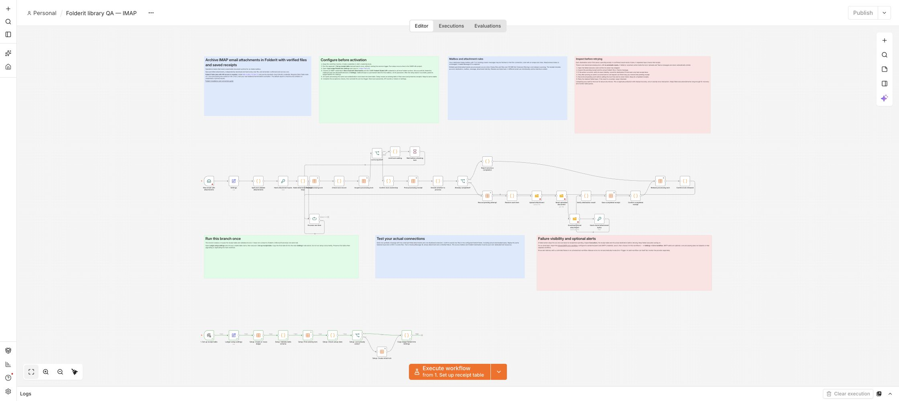
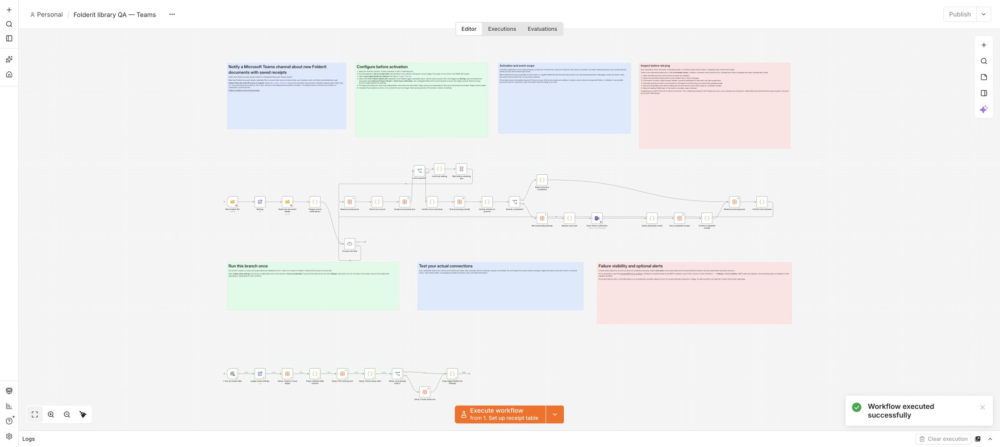
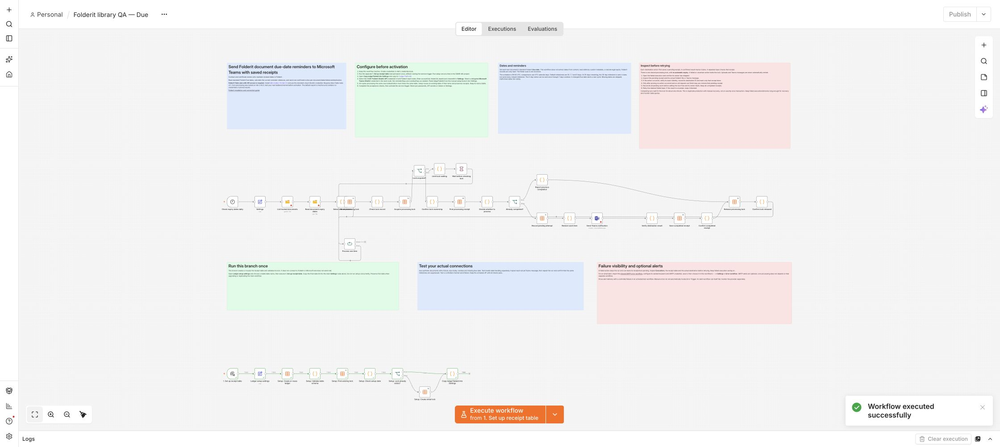

# Folderit workflow library candidates

Three original, inactive workflows for Folderit Tailor customers with API access. Each JSON includes a manual receipt-table setup branch, provider instructions, duplicate handling, recovery notes and acceptance checks. No credential or private fixture is included.

- [Archive IMAP attachments](archive-imap-attachments.json): filter attachments, archive permitted files, independently download/hash new uploads, and record confirmed results.
- [Notify Teams about new documents](notify-teams-on-new-documents.json): read Folderit arrival events and post one confirmed notice per event/destination receipt.
- [Remind Teams about Due dates](remind-teams-about-due-dates.json): read standard Due dates and send current-window milestone reminders.

## Start in your own n8n instance

1. Install the Folderit integration. [Installation and API connection guide](https://www.folderit.com/knowledge-base/connect-folderit-to-n8n/). API access requires the Folderit Tailor plan. These templates use standard-cloud **Folderit OAuth2 API** credentials, compatible with the verified 0.4.0 integration and published 0.5.0. They require n8n Data Table node v1.1.
2. Download one JSON, open an n8n workflow and choose **⋯ → Import from File**. Keep it inactive.
3. Create the required provider credentials in n8n's credential store. Never enter API secrets or mailbox passwords in Settings or workflow JSON.
4. In the imported workflow, find the lower manual branch named **1. Set up receipt table**. Choose a stable table name in **Ledger setup settings** and execute only that branch. Run setup once at a time in the same n8n project. This branch creates local n8n data only; it does not send mail or change Folderit.
5. Copy `ledgerTableId` from **Copy ledgerTableId into Settings** into the main **Settings** node. Replace every `YOUR_…` value and select credentials in every service node. Copies that should suppress the same input must share the same table.
6. Read the provider, acceptance and recovery notes. Test actual destination output, repeats, a controlled failure and manual recovery with synthetic data before activation.
7. Optional: import the [shared SMTP failure-alert workflow](support/folderit-failure-alert-email.json), configure its real sender/recipient and SMTP credential, then select it under the main workflow's **⋯ → Settings → Error workflow**. Core processing does not depend on this optional alert workflow. Prove the alert using a controlled error in an activated test workflow; manual errors do not invoke Error Trigger automatically.

A created folder/file belongs in Folderit. An n8n Data Table belongs inside that n8n project. Downloaded workflow binaries stay in n8n until a person downloads them or a later node stores them elsewhere; no Windows/macOS directory is created automatically.

## Validation and current status

These files are **candidates for n8n's template library**, not approved library listings. The underlying processing already passed native Folderit upload/read/download, duplicate/overlap, interrupted-result and recovery tests. Microsoft delivery used a local provider stub in those earlier tests. Current exact-file import and setup results are tracked with the release evidence.

Real IMAP intake passed in n8n Cloud on 28 October 2026: two permitted synthetic attachments were saved, independently downloaded and matched by SHA-256; the disallowed extension was absent. A repeat left exactly the same two files and two completed receipts, with the processing lock released. The live test found and corrected native IMAP Message-ID mapping. Use this current starter pack for that correction.

Real Microsoft Teams delivery also passed in n8n Cloud. A scheduled arrival notice matched the exact test folder; documents in the other folder were excluded. Due-date tests produced the expected upcoming, due-today and overdue reminders, while skipping a far-future document and a document without a date. Independent Microsoft Graph reads verified the actual message bodies, identities and destination. Replaying both workflows preserved their message IDs. A changed Due date produced one new reminder with overlapping workflow copies sharing the same receipts.

A controlled send failure preserved a pending receipt and held its isolated processing lock. A fresh replay stopped after bounded waiting without repeating the destination action; the normal workflow ledgers stayed free and unchanged. Further error cases have regression coverage, rather than claims of universal provider acceptance. Optional external SMTP delivery is still unverified. Test every workflow in your own account before activation. The account owner's agreement to n8n's template terms remains required before library submission.

Read the [processing and manual-recovery guide](https://github.com/folderit-dms/n8n-nodes-folderit/blob/main/CUSTOMER-WORKFLOWS.md#recovery-inspect-before-retrying). A pending result can mean the external action happened. Keep pending receipts and the lock held until its outcome is established. There is no exactly-once guarantee across services.

Historical customer ZIPs and npm packages remain unchanged. Current attachment-workflow source JSONs include the IMAP correction. For dedicated/custom-domain connections, use the current JSONs in the [deployment guide](https://github.com/folderit-dms/n8n-nodes-folderit/blob/main/examples/deployments/CUSTOMER-WORKFLOWS.md); these three library candidates retain the standard-cloud credential setup.

## Workflow images

